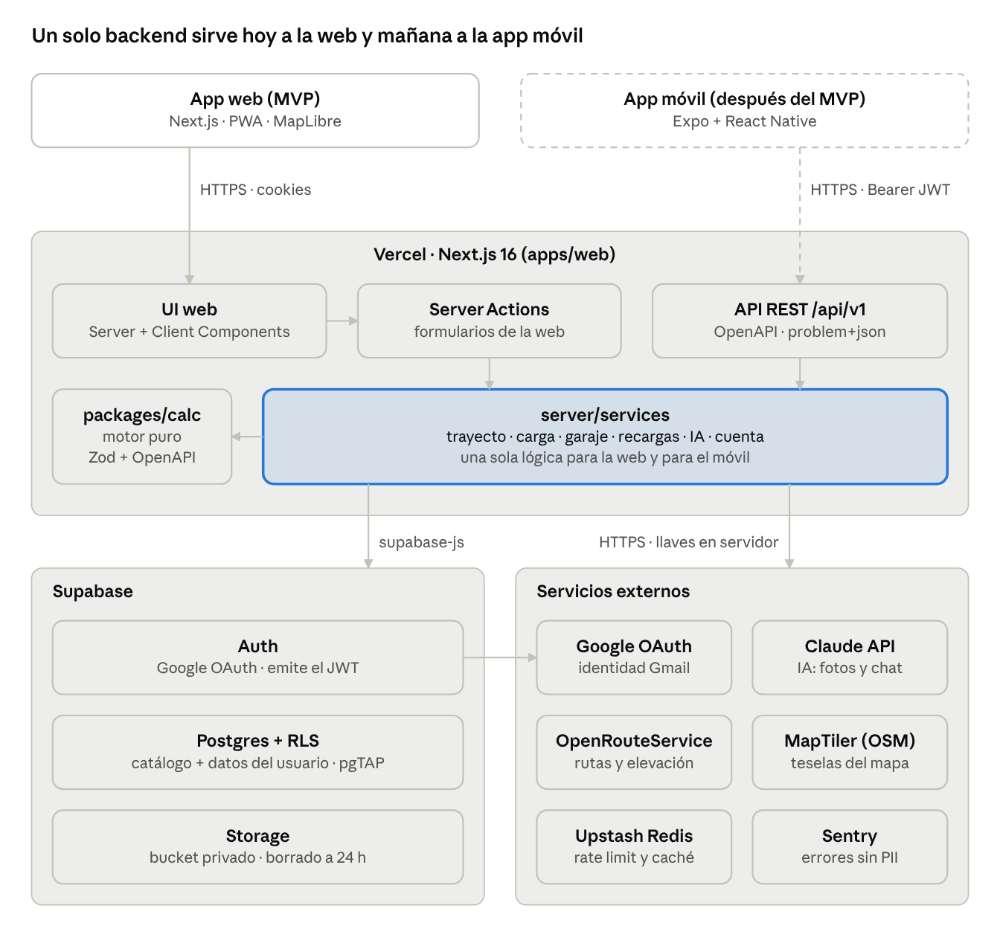
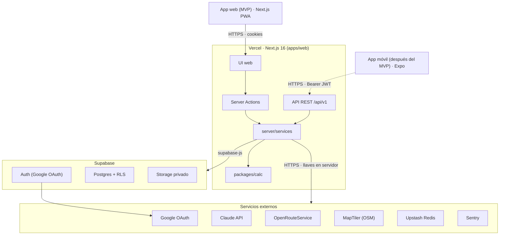
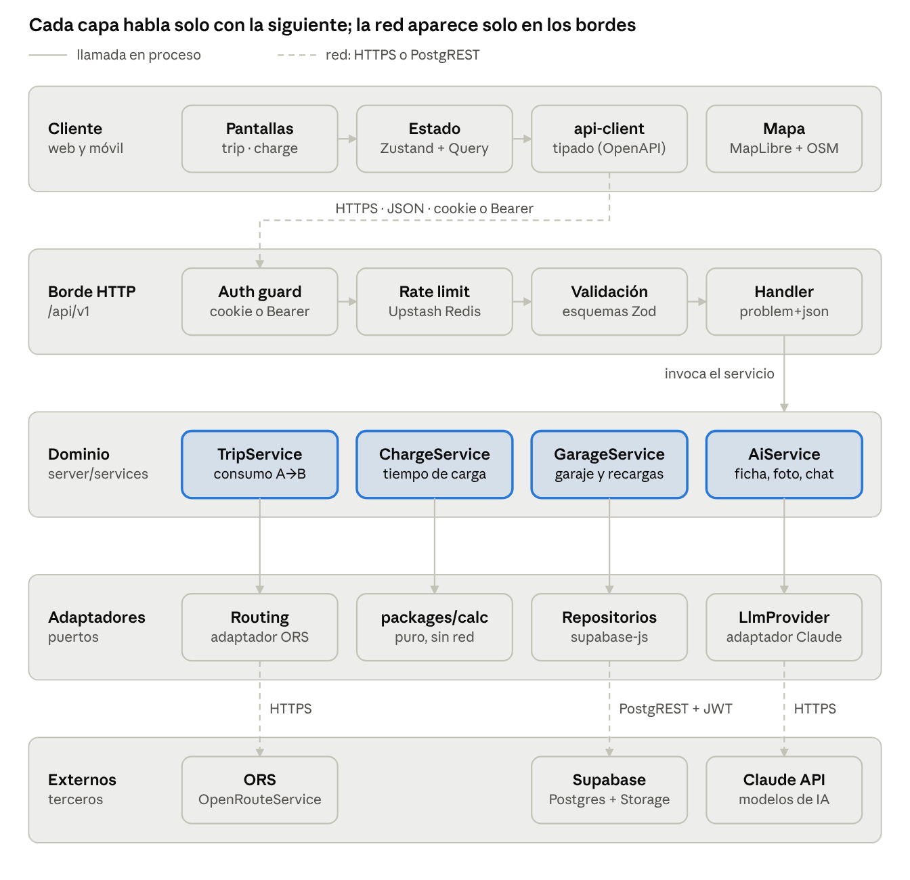
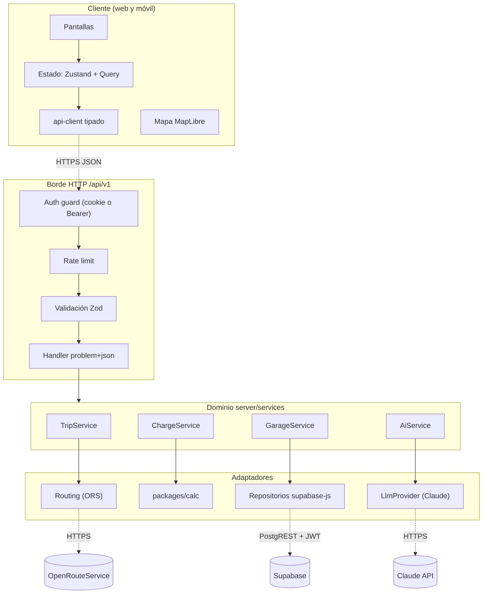

# Plan del proyecto: Elacharger — calculadora EV

Oct 31, 2026 · @carlos polanco

Elacharger es una app web responsive (Next.js + Tailwind + Supabase) que calcula el consumo de batería de un trayecto A→B y el tiempo de carga hasta un % objetivo, partiendo del vehículo, el cargador y el voltaje de entrada. Este documento es la especificación para ejecutar en Claude Code.

## Alcance del MVP

El MVP entrega, tras iniciar sesión con una cuenta Gmail, tres capacidades: calcular consumo A→B en mapa, calcular tiempo de carga a un % objetivo, y gestionar vehículos y cargadores. El registro de recargas y estadísticas (objetivo del proyecto Elacharger) entra en la fase 6, con el modelo de datos listo desde el inicio.

| Capacidad | Entra en MVP | Detalle |
| --- | --- | --- |
| Calculadora de trayecto A→B | Sí | Selección en mapa o búsqueda de dirección; ruta real, distancia, desnivel, % de batería consumido y % de llegada |
| Calculadora de tiempo de carga | Sí | % actual → % objetivo; tiempo considerando potencia del cargador, voltaje, límite AC/DC del carro y curva de carga |
| Garaje de vehículos | Sí | Elegir marca → modelo → versión y la app trae la ficha técnica; si no existe, la busca y extrae con IA |
| Cargadores | Sí | Buscar por marca y modelo (wallbox o portátil) o por conector en estación pública; luego voltaje 110/120, 208/220/240 V, monofásico/trifásico y amperaje del circuito |
| Historial de cálculos | Sí | Guardar y repetir trayectos y cargas |
| Registro de recargas y estadísticas | Fase 6 | kWh cargados, costo, km entre cargas, consumo real kWh/100 km |
| App móvil nativa | No | Fuera del MVP, pero el backend queda listo desde el inicio (ver Backend listo para apps móviles); la web es responsive e instalable como PWA |
| Tráfico en tiempo real y estaciones públicas | No | Evaluar después del MVP |

Vehículo de ejemplo: la ficha del Deepal S05 adjunta al proyecto (56,12 kWh LFP, 458 km NEDC, 30–100 % en \~60 min) se usa solo como caso de prueba del motor de cálculo y de la extracción con IA. En la app, el usuario elige cualquier marca y modelo del catálogo (ver F3).

Cuando un dato no aparece en ninguna fuente (la ficha de ejemplo, por ejemplo, no trae la potencia de carga AC ni DC), la app lo marca "Por confirmar" y el usuario puede completarlo.

## Stack técnico

Next.js 16 (App Router) con TypeScript estricto, Tailwind CSS v4 y Supabase (Postgres + Auth + RLS); los mapas usan MapLibre y el enrutamiento OpenRouteService detrás de un proxy propio.

| Capa | Elección | Por qué |
| --- | --- | --- |
| Framework | Next.js 16.x, App Router, Server Components, Server Actions, Turbopack | Línea estable actual (16.4.1 al 15-oct-2026, [fuente](https://www.versio.io/de/product-release-end-of-life-eol-vercel-nextjs.html)); requiere Node 20+ |
| Lenguaje | TypeScript `strict`, `noUncheckedIndexedAccess` | Errores de cálculo detectados en compilación |
| Estilos | Tailwind CSS v4 + shadcn/ui (Radix) + lucide-react | Componentes accesibles, tokens de diseño en CSS |
| Formularios y validación | react-hook-form + Zod (mismo esquema en cliente y servidor) | Una sola fuente de verdad para validar |
| Backend / BD | Supabase: Postgres, Auth, RLS, migraciones con Supabase CLI | Todo se graba en Supabase |
| Sesión | `@supabase/ssr` con cookies + middleware que refresca la sesión | Patrón recomendado para App Router ([fuente](https://supabase.com/kb/faqs/nextjs/authentication-nextjs)) |
| Mapa | MapLibre GL JS vía `react-map-gl/maplibre`, teselas OSM (MapTiler o Stadia) | Sin costo por carga de mapa, open source |
| Ruta, geocoding, elevación | OpenRouteService (`driving-car`, `elevation=true`) llamado solo desde un Route Handler | Plan gratuito: 2.000 rutas/día y 1.000 geocodificaciones/día ([fuente](https://openrouteservice.org/plans/)) |
| Estado cliente | Zustand (preferencias, borrador de cálculo) + TanStack Query para datos remotos | Simple y cacheable |
| Gráficas | Recharts | Curva de carga y estadísticas |
| Rate limiting | Upstash Redis + `@upstash/ratelimit` | Protege la cuota de ORS |
| Pruebas | Vitest (unitarias del motor de cálculo), Playwright (E2E), Testing Library | El cálculo es el núcleo: cobertura ≥ 90 % |
| Calidad | ESLint (next + typescript-eslint), Prettier, Husky + lint-staged, commitlint | Consistencia y commits convencionales |
| CI/CD | GitHub Actions (lint, typecheck, test, build) + Vercel previews | Cada PR desplegado y probado |
| Observabilidad | Sentry + Vercel Analytics | Errores y Web Vitals |

Alternativa al mapa: Mapbox o Google Routes si se requiere tráfico real; el motor de cálculo no cambia porque el proveedor queda detrás de una interfaz `RoutingProvider`.

## Diagrama de arquitectura





La web entra con cookies y la futura app móvil con token Bearer; ambas llegan a la misma capa `server/services`, que es la única que habla con Supabase y con los servicios externos. Las llaves de ORS, Claude y Upstash nunca salen del servidor; solo las teselas del mapa se piden desde el navegador.

## Diagrama de componentes y conectores





Una petición pasa por el borde en orden fijo (sesión, rate limit, validación) antes de llegar a un servicio. Los servicios dependen de interfaces (`RoutingProvider`, `LlmProvider`, repositorios), no de proveedores concretos, y todos usan `packages/calc` y los repositorios; el diagrama muestra solo la dependencia principal de cada uno. Cambiar ORS por Mapbox o Claude por otro modelo es cambiar un adaptador.

## Backend listo para apps móviles

El MVP es web, pero el backend se construye API-first: una futura app Android/iOS (recomendado Expo + React Native) debe poder usar el mismo backend sin reescribir lógica. La web es solo el primer cliente.

Decisiones:

1. **Monorepo** con pnpm + Turborepo: `apps/web` (Next.js), espacio reservado para `apps/mobile`, y paquetes compartidos `packages/calc` (motor de cálculo), `packages/schemas` (Zod), `packages/types` (tipos generados de Supabase) y `packages/api-client` (cliente tipado). El motor y las validaciones son TypeScript puro, sin dependencias de Next ni del DOM, para reutilizarlos en React Native.
2. **API REST versionada** en `apps/web/src/app/api/v1/*` (Route Handlers) para toda operación con lógica, secretos o terceros: cálculo de trayecto, cálculo de carga, geocoding y rutas ORS, IA, estadísticas, borrado y exportación de cuenta. Las Server Actions de la web llaman a la misma capa de servicios (`server/services/*`); nunca hay lógica de negocio solo en una Server Action o en un componente.
3. **CRUD simple** (vehículos, cargadores, historial, recargas) puede ir por `supabase-js` directo desde cualquier cliente, porque la frontera de seguridad real es RLS; la API v1 expone también esos recursos para clientes que prefieran un solo contrato.
4. **Autenticación dual**: la web usa cookies (`@supabase/ssr`); la API acepta `Authorization: Bearer <access_token de Supabase>` y valida el JWT en servidor con `getUser()`/`getClaims()`. Las rutas `/api/v1` nunca redirigen a `/login`: responden 401 en JSON.
5. **Google en móvil**: inicio de sesión nativo con Google y `supabase.auth.signInWithIdToken({ provider: 'google', token })`; en Google Cloud se crean clientes OAuth de Android e iOS y sus Client IDs se agregan a la lista de IDs autorizados del proveedor Google en Supabase. Deep links (`elacharger://auth/callback`) en la lista de redirecciones.
6. **Contrato**: esquema OpenAPI 3.1 generado desde los Zod (`@asteasolutions/zod-to-openapi`) y publicado en `/api/v1/openapi.json`; el cliente tipado de `packages/api-client` se genera de ahí.
7. **Convenciones de la API**: JSON con unidades SI y nombres en `snake_case`, fechas ISO 8601 en UTC, errores con formato `application/problem+json` (RFC 9457), paginación por cursor, cabecera `Idempotency-Key` en POST que crean registros, rate limit por `user_id` del token, y `GET /api/v1/meta` con versión mínima soportada del cliente.
8. **Archivos** (fotos de recargas, fichas técnicas): subida con URL firmada de Supabase Storage (`createSignedUploadUrl`), así el móvil sube directo desde la cámara sin pasar por el servidor.
9. **Preparado para push**: tabla futura `device_tokens` (user\_id, plataforma, token, último uso) para avisar "carga lista" vía Expo Push/FCM/APNs; no se implementa en el MVP.
10. **Pruebas de contrato**: cada endpoint tiene pruebas que validan respuestas contra el OpenAPI, y una prueba E2E que llama la API solo con Bearer (sin cookies) para garantizar que un cliente móvil funcionará.

Criterio de "backend listo para móvil": se puede crear un vehículo, calcular un trayecto y una carga, y registrar una recarga usando solo `curl` con un token Bearer y la documentación OpenAPI.

## Funcionalidades y fórmulas de cálculo

Toda la lógica vive en un paquete puro `lib/calc/` (sin React ni red), con unidades SI internas, pruebas unitarias y constantes configurables; la UI solo muestra resultados.

### F0. Autenticación con cuenta Gmail

Toda la app requiere iniciar sesión con una cuenta Google (Gmail); no hay usuario y contraseña propios. Se implementa con el proveedor Google OAuth 2.0 de Supabase Auth y el flujo PKCE de `@supabase/ssr`.

1. Google Cloud Console: crear proyecto, pantalla de consentimiento (nombre Elacharger, logo, enlaces a privacidad y términos) y un cliente OAuth tipo "Aplicación web" con URI de redirección `https://<proyecto>.supabase.co/auth/v1/callback`.
2. Supabase → Authentication → Providers → Google: pegar Client ID y Client Secret (viven solo en Supabase, nunca en el repo). Scopes mínimos: `openid email profile`.
3. Supabase → URL Configuration: Site URL de producción y lista de redirecciones permitidas (`http://localhost:3000/**`, previews de Vercel, dominio final).
4. Página `/login` con un único botón "Continuar con Google" que llama `signInWithOAuth({ provider: 'google', options: { redirectTo: <origen>/auth/callback } })`.
5. Route Handler `/auth/callback` que hace `exchangeCodeForSession(code)` y redirige a la página que el usuario intentaba abrir (validando que sea una ruta interna, para evitar open redirect).
6. `middleware.ts` refresca la sesión y redirige a `/login` cualquier ruta del grupo `(app)` sin usuario; las páginas además verifican con `getUser()` en servidor.
7. Primer login: el trigger crea `profiles` con nombre y foto de Google; la app lleva al onboarding (elegir vehículo y cargador).
8. Cerrar sesión en Ajustes con `signOut()`; borrar cuenta elimina el usuario y sus datos en cascada.

Antes de salir a producción, publicar la app OAuth en Google (en modo prueba solo entran los usuarios de prueba registrados). Opcional: restringir el acceso a una lista de correos permitidos con una tabla `allowed_emails` y verificación en el callback.

### F1. Consumo de batería del punto A al punto B

Flujo: el usuario toca el mapa (o busca dirección) para A y B → el servidor pide la ruta a ORS con elevación → el motor calcula energía y % → la UI muestra % consumido, % de llegada y si llega con reserva.

Entradas: vehículo, % de batería actual, pasajeros y carga extra (kg), aire acondicionado sí/no, estilo de manejo (eco, normal, deportivo), temperatura exterior (opcional), reserva mínima (por defecto 10 %).

Energía del trayecto:

```latex
E_{viaje} = \frac{d}{100}\, c_{base}\, f_{vel}\, f_{estilo}\, f_{clima}\, f_{AC} + \frac{m\, g\, (H_{sub}/\eta_{tren} - H_{baj}\,\eta_{regen})}{3{,}6\times10^{6}}
```

- d = distancia en km (ORS); H\_sub y H\_baj = ascenso y descenso acumulados en m (ORS `ascent`/`descent`).
- c\_base = consumo base en kWh/100 km. Si el usuario no lo da: capacidad útil ÷ autonomía homologada × 100 × factor real (NEDC 1,30; WLTP 1,15; EPA 1,00; CLTC 1,35, por calibrar con datos reales). Ejemplo con el Deepal S05: 56,12 ÷ 458 × 100 × 1,30 ≈ 15,9 kWh/100 km.
- m = peso vacío + pasajeros (75 kg c/u) + carga; g = 9,81; η\_tren = 0,90; η\_regen = 0,60.
- f\_vel según velocidad media del tramo (distancia ÷ duración ORS): < 50 km/h → 0,90; 50–80 → 1,00; 80–100 → 1,12; > 100 → 1,25.
- f\_estilo: eco 0,92, normal 1,00, deportivo 1,15. f\_AC: 1,06 si está encendido. f\_clima: 1,00 entre 15–28 °C, 1,08 entre 5–15 °C, 1,20 bajo 5 °C.
- Si la ruta tiene varios segmentos, se calcula por segmento y se suma (más preciso en rutas de montaña).

Resultados: kWh, % consumido = E ÷ capacidad útil × 100, % de llegada = % actual − % consumido, autonomía restante en km, alerta si el % de llegada < reserva, y la parada de carga sugerida (fase 6). Siempre se muestra como estimación con margen ±10 %.

### F2. Tiempo de carga hasta un % objetivo

Entradas: vehículo, cargador (tipo, voltaje, amperaje, fases, potencia nominal), % actual y % objetivo, tarifa COP/kWh opcional.

Potencia efectiva en AC:

```latex
P_{AC} = \min\left(\frac{V\,I\,k_{fases}}{1000},\; P_{cargador},\; P_{a\,bordo}\right),\quad k_{fases}=1\ (\text{monof.}),\ \sqrt{3}\ (\text{trif.})
```

Potencia en DC: min(P\_cargador, P\_DC máx del vehículo, curva del vehículo en ese %).

Tiempo: se integra en pasos de 1 % de batería, porque la potencia baja cerca del 100 %:

```latex
t = \sum_{s=s_0}^{s_1-1} \frac{C_{util}/100}{\min(P_{ef},\,P_{curva}(s))\cdot\eta}
```

- η (eficiencia red→batería): 110–120 V = 0,85; 208–240 V AC = 0,90; DC = 0,93. Editables.
- Curva por defecto si el vehículo no trae una: 100 % de potencia hasta 80 %, 60 % entre 80–90 %, 35 % entre 90–100 % (DC); en AC 100 % hasta 95 % y 50 % después.
- Ejemplo con el Deepal S05: la ficha indica 30→100 % en \~60 min, es decir \~39 kWh en 1 h; la curva por defecto se calibra con ese dato en las pruebas. Cada modelo usa su propia curva del catálogo cuando existe.

Resultados: tiempo (h:min), hora estimada de fin, kWh tomados de la red, costo, km de autonomía ganados, y gráfica % vs tiempo.

Casos de prueba obligatorios (Vitest), batería útil 56,12 kWh:

| Caso | Entrada | Resultado esperado aprox. |
| --- | --- | --- |
| Nivel 1 doméstico | 110 V, 12 A, 20 → 80 % | \~1,12 kW efectivos, \~30 h |
| Nivel 2 doméstico | 220 V, 32 A monofásico, cargador a bordo 6,6 kW, 20 → 80 % | \~5,9 kW efectivos, \~5 h 40 min |
| Rápido DC | 60 kW, 30 → 100 % | \~60 min (calibración ficha) |
| Objetivo menor que actual | 80 → 50 % | Error de validación |
| Trayecto plano | 100 km, 0 m desnivel, normal, sin AC | 15,9 kWh, 28,3 % |
| Subida | +1.000 m netos, 1.927 kg | +5,8 kWh sobre el plano |

### F3. Catálogo de vehículos y cargadores

El usuario nunca escribe la ficha técnica a mano: elige marca, modelo y versión, y la app trae la ficha del catálogo. Si su carro o su cargador no aparece, la app lo busca, extrae la ficha con IA y la deja para que la confirme.

Flujo del vehículo:

1. Marca (buscador con autocompletar) → Modelo → Año y versión (batería, tracción).
2. La app muestra la ficha: batería bruta y útil, autonomía y ciclo (NEDC/WLTP/EPA), consumo, peso, cargador a bordo AC (kW y fases), DC máximo (kW), conectores AC y DC y curva de carga si existe. Cada dato muestra su fuente y fecha.
3. El usuario confirma y el carro queda en su garaje enlazado a esa versión del catálogo. Si corrige un dato, la corrección se guarda solo para él, sin tocar el catálogo.
4. "No encuentro mi carro": escribe marca y modelo, o sube la ficha o una foto (IA1). El servidor busca la ficha, la extrae con IA, la valida con Zod y la muestra con confianza por campo. Al confirmar, queda en el catálogo como aporte pendiente de verificación y, una vez verificada, sirve a todos los usuarios.

Flujo del cargador:

1. ¿Dónde carga?: en casa (wallbox o cargador portátil del carro) o en estación pública.
2. En casa: busca su cargador por marca y modelo y la app trae potencia nominal, fases, amperaje máximo y ajustable, y conector. Luego elige el voltaje de entrada con chips (110, 120, 208, 220, 240 V o valor libre, monofásico o trifásico) y el amperaje del circuito; la UI muestra los kW resultantes en vivo.
3. En estación pública: elige el tipo de conector y la potencia. Los tipos de conector, niveles de carga y AC/DC vienen de los datos de referencia de Open Charge Map; buscar estaciones cercanas queda para después del MVP.
4. Si el cargador no aparece, se usa la misma búsqueda con IA que para vehículos.
5. Validación cruzada: compatibilidad de conector entre carro y cargador (o adaptador), potencia efectiva = mínimo entre cargador, circuito y cargador a bordo del carro, y aviso si el amperaje supera lo típico del circuito (por ejemplo, 110 V con más de 16 A).

Fuentes de datos del catálogo:

| Fuente | Qué aporta | Condiciones | Uso en Elacharger |
| --- | --- | --- | --- |
| Catálogo propio en Supabase | Todo lo anterior, normalizado, con fuente por campo | Propio | La única fuente que lee la app; las demás solo lo alimentan |
| [Open EV Data](https://github.com/KilowattApp/open-ev-data) | Marca, modelo, variante, año, batería, carga AC y DC, consumo | Licencia MIT con atribución obligatoria; repositorio archivado (solo lectura) desde mayo de 2025 | Importación inicial única |
| [EPA fueleconomy.gov](https://fueleconomy.gov/feg/ws) | Consumo en kWh/100 mi, autonomía, horas de carga a 120 V y 240 V | Servicio web público en JSON/XML; modelos del mercado de EE. UU. | Importación y validación cruzada |
| [EV Database](https://ev-database.org/data-services-api) | Fichas detalladas y modelos descontinuados (Alemania, Países Bajos, Reino Unido) | API de pago por módulos, solo para empresas registradas; demo gratuita | Opcional si el proyecto crece |
| [Open Charge Map](https://apis.io/apis/api-evangelist-openchargemap/openchargemap-referencedata-api/) | Tipos de conector, niveles de carga, AC/DC, operadores | API con llave gratuita | Catálogo de conectores; estaciones en el futuro |
| Búsqueda + extracción con IA | Modelos de carros y cargadores que falten en las fuentes anteriores | Costo por uso de la API de Claude; rate limit | Bajo demanda, siempre con confirmación del usuario |

Reglas del catálogo:

- Cada dato guarda `source`, `source_url`, `retrieved_at` y `confidence`; lo que ninguna fuente trae se muestra como "Por confirmar" y el usuario puede completarlo.
- El catálogo es global y de solo lectura para los usuarios; solo escriben los procesos del servidor. Los aportes de usuarios entran como `pending` y se publican tras revisión de un administrador.
- Sincronización: un job semanal (Supabase Cron o GitHub Action) reimporta las fuentes vivas, registra cada cambio y nunca pisa un dato verificado a mano.
- Búsqueda tolerante a errores de escritura con la extensión `pg_trgm` de Postgres ("deepal s05", "Deepal S-05").
- Endpoints para web y móvil: `GET /api/v1/catalog/brands`, `/catalog/models?brand=`, `/catalog/variants/{id}`, `/catalog/chargers?q=`, `/catalog/connectors` y `POST /api/v1/catalog/lookup` (búsqueda con IA, con rate limit).
- Crédito a "Open EV Data" en la página Acerca de, como exige su licencia.
- Antes de la fase 3, medir la cobertura del catálogo con los modelos más vendidos en Colombia y completar con el lookup de IA los que falten.

## Modelo de datos en Supabase

Tres grupos de tablas (catálogo compartido, datos de cada usuario e IA de la fase 8) en el esquema `public`, todas con RLS activado y migraciones versionadas en `supabase/migrations`; ningún dato se escribe sin pasar por Zod en el servidor y por los `CHECK` de Postgres.

| Tabla | Propósito | Columnas clave | Política RLS |
| --- | --- | --- | --- |
| `profiles` | Preferencias del usuario | `id` (= `auth.users.id`), `display_name`, `units`, `currency` (COP), `tariff_per_kwh`, `default_vehicle_id`, `reserve_pct` | Solo el dueño lee y edita su fila |
| ev\_brands, ev\_models | Catálogo: marcas y modelos | brand: name, slug, country, logo\_path · model: brand\_id, name, slug, body\_type, markets (array: CO, US, EU…), aliases (array para búsqueda) | Lectura para usuarios autenticados; escritura solo desde el servidor |
| ev\_variants | Catálogo: ficha técnica por año y versión | model\_id, year\_from, year\_to, trim, battery\_gross\_kwh, battery\_usable\_kwh, chemistry, range\_km, range\_cycle, consumption\_kwh\_100km, curb\_weight\_kg, ac\_onboard\_kw, ac\_phases, dc\_max\_kw, connector\_ac\_id, connector\_dc\_id, charge\_curve (jsonb), field\_sources (jsonb: fuente, url, fecha y confianza por campo), status (verified, pending) | Lectura para usuarios autenticados (solo verified, o pending si es su aporte); escritura solo desde el servidor |
| charger\_models | Catálogo: cargadores (wallbox y portátiles) | brand, model, kind (wallbox, portátil), rated\_kw, phases, max\_amperage\_a, adjustable\_amperage (array), input\_voltage\_min/max, connector\_type\_id, tethered\_cable, field\_sources (jsonb), status | Lectura para usuarios autenticados; escritura solo desde el servidor |
| connector\_types | Catálogo: conectores de referencia | code (TYPE1, TYPE2, CCS1, CCS2, CHADEMO, GBT\_AC, GBT\_DC, NACS…), name, current (AC, DC), max\_kw\_typical, ocm\_id (id en Open Charge Map), compatible\_adapters (array) | Lectura pública; escritura solo desde el servidor |
| catalog\_submissions | Aportes y búsquedas con IA de modelos que faltan | user\_id, kind (vehicle, charger), query, extracted (jsonb), sources (jsonb), status (pending, approved, rejected), reviewed\_by, created\_variant\_id | El usuario crea y lee los suyos; revisión solo por administradores |
| catalog\_sync\_runs | Bitácora de importaciones del catálogo | source, started\_at, finished\_at, inserted, updated, skipped\_verified, errors (jsonb) | Sin acceso desde el cliente |
| `vehicles` | Garaje: el carro del usuario, enlazado a una versión del catálogo | `owner_id`, `variant_id` (FK a `ev_variants`; null si se creó a mano), `nickname`, `overrides` (jsonb: datos que el usuario corrigió), `battery_health_pct` | CRUD solo del dueño |
| `chargers` | Cargadores del usuario, enlazados al catálogo | `owner_id`, `charger_model_id` (FK a `charger_models`; null si es manual), `name`, `use` (casa, pública), `voltage_v`, `phases` (1 o 3), `circuit_amperage_a`, `connector_type_id`, `efficiency` | CRUD solo del dueño |
| `trip_calculations` | Historial A→B | `user_id`, `vehicle_id`, `origin_lat/lng/label`, `dest_lat/lng/label`, `distance_km`, `duration_min`, `ascent_m`, `descent_m`, `route_polyline`, `start_soc`, `energy_kwh`, `consumed_pct`, `arrival_soc`, `inputs` (jsonb), `engine_version` | CRUD solo del dueño |
| `charge_calculations` | Historial de cálculos de carga | `user_id`, `vehicle_id`, `charger_id`, `start_soc`, `target_soc`, `effective_kw`, `energy_grid_kwh`, `duration_min`, `cost`, `inputs`, `engine_version` | CRUD solo del dueño |
| `charging_sessions` | Recargas reales (fase 6) | `user_id`, `vehicle_id`, `charger_id`, `started_at`, `ended_at`, `start_soc`, `end_soc`, `energy_kwh`, `cost`, `odometer_km`, `location_label`, `notes` | CRUD solo del dueño |
| `audit_log` | Eventos sensibles (login, borrado de cuenta) | `user_id`, `event`, `metadata`, `created_at` | Insert vía función; sin lectura desde el cliente |
| ai\_extractions | Borradores extraídos por IA (fase 8) | user\_id, kind (vehicle\_spec, charging\_receipt), storage\_path, extracted (jsonb), confidence (jsonb), status (pending, confirmed, discarded), model, created\_at | CRUD solo del dueño |
| ai\_conversations | Historial del asistente (fase 8, opcional) | user\_id, title, messages (jsonb), created\_at, updated\_at | CRUD solo del dueño |
| ai\_usage | Consumo y límites de IA (fase 8) | user\_id, feature, model, input\_tokens, output\_tokens, est\_cost\_usd, created\_at | El dueño solo lee; insert solo desde el servidor |

Reglas de base de datos:

- Políticas separadas por operación (`select`, `insert`, `update`, `delete`) con `(select auth.uid()) = user_id`; nunca `using (true)` en tablas de usuario.
- `CHECK`: `soc` entre 0 y 100, `target_soc > start_soc`, `voltage_v` entre 100 y 1000, `phases in (1,3)`, `amperage_a` entre 1 y 500, capacidad útil ≤ bruta, lat −90..90 y lng −180..180.
- `charge_curve` validado con `jsonb_matches_schema` o función `CHECK` (lista de pares `soc` 0–100 → `kw` > 0).
- Índices `(user_id, created_at desc)` en historiales; FK con `on delete cascade` hacia `auth.users`.
- Trigger `handle_new_user` (`security definer`, `set search_path = ''`) crea el perfil al registrarse; trigger `updated_at` en todas las tablas.
- `engine_version` guarda la versión del motor de cálculo para explicar diferencias históricas.
- Seed: importación inicial del catálogo de vehículos, cargadores y conectores (F3), priorizando los modelos vendidos en Colombia; tipos generados con `supabase gen types typescript`.
- Pruebas de RLS con pgTAP: un usuario no puede leer ni modificar filas de otro.

## Experiencia de usuario y responsive

Mobile-first: el caso principal es alguien en el carro con el teléfono, así que cada cálculo debe resolverse en menos de 30 segundos y con una mano.

Mockups: carpeta `docs/mockups/` y lienzo [Elacharger — Mockups](https://claude.ai/artifact/X4LJ7cG4HBUnizijpAmGvY), con 9 pantallas móviles (login, inicio, trayecto, carga, garaje, agregar vehículo, agregar cargador, recargas, asistente) y la vista de trayecto en escritorio. La pantalla de carga es interactiva y usa la misma fórmula de F2.

Pantallas:

1. Inicio: tarjeta del vehículo activo, % de batería editable con un slider grande y dos accesos: "Planear trayecto" y "Calcular carga".
2. Trayecto: mapa a pantalla completa; en móvil un bottom sheet arrastrable con A, B y opciones; en escritorio un panel lateral fijo. Resultado con anillo de batería (salida → llegada) y semáforo verde/ámbar/rojo según la reserva.
3. Carga: sliders de % actual y objetivo, chips de voltaje 110/220 V, selector de cargador; resultado en vivo (sin botón "calcular") con tiempo grande, hora de fin y curva de carga.
4. Garaje: vehículos y cargadores, con "Agregar desde catálogo".
5. Historial: cálculos guardados, repetir con un toque.
6. Recargas y estadísticas (fase 6).
7. Ajustes: unidades, tarifa, reserva, tema claro/oscuro, cerrar sesión, borrar cuenta.

Criterios de UX:

- Breakpoints Tailwind: base (< 640 px) navegación inferior con 4 ítems; `md` panel lateral; `lg` mapa + panel + resultado visibles a la vez.
- Objetivos táctiles ≥ 44 px, inputs numéricos con `inputMode="decimal"`, sliders con paso de 1 % y valor visible.
- Valores por defecto inteligentes: último vehículo, último cargador, reserva 10 %; el acceso exige iniciar sesión con Google y el primer ingreso lleva a un onboarding de un paso (vehículo y cargador).
- "Usar mi ubicación" como punto A (Geolocation API, solo con permiso).
- Estados vacíos, skeletons y errores con acción ("Reintentar", "Ajustar ruta"); optimistic UI al guardar.
- Explicabilidad: botón "¿Cómo se calculó?" que muestra el desglose (consumo base, desnivel, factores).
- Accesibilidad WCAG 2.2 AA: contraste, foco visible, navegación por teclado, `aria-live` para resultados, `prefers-reduced-motion`.
- Formato colombiano por defecto: `es-CO`, coma decimal, COP; i18n preparado con `next-intl`.
- PWA instalable (manifest + íconos); modo oscuro según el sistema.
- Rendimiento: LCP < 2,5 s en 4G, mapa cargado con `dynamic()` sin SSR, debounce de 400 ms en búsqueda de direcciones.

## Seguridad y buenas prácticas

La ubicación (origen y destino) es dato personal bajo la Ley 1581 de 2012, por lo que se trata como sensible: mínimo necesario, cifrado en tránsito, RLS estricta y borrado a petición.

| Área | Control |
| --- | --- |
| Autenticación | Inicio de sesión obligatorio con cuenta Google (Gmail) vía Supabase Auth y Google OAuth 2.0 con PKCE; scopes mínimos; sin contraseñas propias; la verificación en dos pasos la aporta la cuenta Google |
| Sesión | Cookies `HttpOnly`, `Secure`, `SameSite=Lax` vía `@supabase/ssr`; en servidor usar `getUser()`/`getClaims()`, nunca confiar en `getSession()` |
| Autorización | RLS en todas las tablas + verificación de usuario en cada Server Action; `service_role` solo en servidor y nunca con prefijo `NEXT_PUBLIC_` |
| Secretos | `.env.local` fuera de git, variables en Vercel; validación de env al arrancar con Zod (`env.ts`); `server-only` en módulos con secretos |
| API externas | ORS solo desde Route Handler; rate limit por usuario/IP (ej. 30 rutas/min, 300/día); caché de rutas 24 h por par A→B redondeado |
| Validación | Zod en toda entrada (Server Actions, Route Handlers, formularios); límites numéricos iguales a los `CHECK` de BD |
| Cabeceras | CSP estricta con nonce (permitir teselas y ORS), HSTS, `X-Content-Type-Options`, `Referrer-Policy: strict-origin-when-cross-origin`, `Permissions-Policy` (geolocation=self) |
| Protección web | CSRF cubierto por Server Actions + `SameSite`; sin `dangerouslySetInnerHTML` |
| Dependencias | `npm audit` y Dependabot/Renovate; lockfile commiteado; Next.js en la última versión de parche (la línea 16 ha tenido parches de seguridad) |
| Privacidad | Aviso de privacidad y aceptación de tratamiento de datos; exportar y borrar cuenta; no guardar la ruta completa si el usuario lo desactiva |
| Observabilidad | Sentry sin PII (scrub de coordenadas y correo); `audit_log` para eventos sensibles |
| Calidad | Commits convencionales, PR con CI verde obligatoria, revisión de código, cobertura ≥ 90 % en `lib/calc`, SonarCloud o Semgrep en CI |

Principios de código: arquitectura por features (`features/trip`, `features/charge`, `features/garage`), Server Components por defecto y `"use client"` solo donde haya interacción, funciones puras y pequeñas en el motor, sin `any`, nombres en inglés en código y textos de UI en español.

## Funcionalidades de IA

Tres funciones de IA entran en la fase 8: crear vehículos desde la ficha técnica, registrar recargas con una foto y un asistente conversacional. La regla de diseño es que la IA interpreta y extrae, pero nunca calcula: todo número sale del motor `lib/calc`.

| Función | Qué hace el usuario | Qué hace la IA | Qué se guarda |
| --- | --- | --- | --- |
| IA1. Vehículo desde ficha técnica | Sube PDF o foto de la ficha | Extrae marca, modelo, batería bruta/útil, autonomía y ciclo, peso, potencias AC/DC y conector, con nivel de confianza por campo | Borrador en `ai_extractions`; el usuario revisa y confirma antes de crear el `vehicle` |
| IA2. Recarga desde foto | Toma foto del cargador, recibo o tablero | Extrae kWh, costo, % inicial y final, fecha y odómetro | Borrador prellenado del formulario de `charging_sessions`; nada se guarda sin confirmar |
| IA3. Asistente | Pregunta en texto ("¿Llego a Medellín con 70 %?") | Entiende la intención y llama herramientas: `get_vehicles`, `get_chargers`, `geocode`, `estimate_trip`, `estimate_charge_time`, `get_stats` | Conversación en `ai_conversations` (opcional, el usuario puede desactivarla) |

Implementación:

1. Proveedor: API de Claude (Anthropic) con el SDK `@anthropic-ai/sdk`, llamada solo desde Route Handlers con `server-only`; llave `ANTHROPIC_API_KEY` en variables de entorno.
2. Modelos: uno rápido y económico para IA1 e IA2 (extracción con visión) y uno de mayor capacidad para IA3; nombres de modelo en `AI_MODEL_EXTRACTION` y `AI_MODEL_ASSISTANT`, no fijos en el código.
3. Salida estructurada: IA1 e IA2 usan tool use con un esquema JSON que se valida con Zod; si un campo no pasa la validación queda vacío y marcado para el usuario.
4. IA3 usa el bucle de tool use: cada herramienta es un wrapper delgado sobre `lib/calc` y las consultas de Supabase del propio usuario (RLS aplica igual). Respuesta en streaming en la UI.
5. Archivos: PDF hasta 10 MB e imágenes hasta 5 MB, validados por tipo MIME real; se guardan temporalmente en Supabase Storage (bucket privado por usuario) y se borran a las 24 h.
6. UX: botón "Importar ficha" en Garaje, botón de cámara en Recargas y un botón flotante de asistente; en cada resultado se ve qué campos vinieron de la IA y su confianza.

Seguridad y costos de la IA:

- El contenido de PDFs, fotos y conversaciones se trata como datos, nunca como instrucciones (mitigación de prompt injection); el system prompt lo indica y las herramientas solo leen o calculan, nunca borran.
- Las herramientas reciben el `user_id` desde la sesión del servidor, nunca desde el modelo.
- Se envía lo mínimo: sin correo ni nombre; coordenadas redondeadas a 3 decimales.
- Límites: 20 extracciones y 50 mensajes de asistente por usuario al día, tope mensual de gasto global; todo registrado en `ai_usage` (tokens de entrada/salida, función, costo estimado).
- Pruebas: conjunto de 10 fichas y 10 fotos de ejemplo con valores esperados (evals) que corre en CI con respuestas grabadas, y prueba manual con la API real antes de cada release.

## Estructura del repositorio

```text
elacharger/                     # monorepo pnpm + Turborepo
├─ CLAUDE.md                     # reglas del proyecto para Claude Code
├─ docs/PLAN.md                  # este documento exportado a Markdown
├─ apps/
│  ├─ web/                       # Next.js 16 (MVP)
│  │  └─ src/
│  │     ├─ app/
│  │     │  ├─ (auth)/login, auth/callback
│  │     │  ├─ (app)/            # inicio, trip, charge, garage, history, sessions, settings
│  │     │  └─ api/v1/           # API REST pública para web y móvil
│  │     │     ├─ health, meta, openapi.json
│  │     │     ├─ vehicles, chargers, sessions, history
│  │     │     ├─ calc/trip, calc/charge
│  │     │     ├─ routing/directions, routing/geocode
│  │     │     ├─ ai/extract, ai/assistant
│  │     │     └─ account/export, account/delete
│  │     ├─ server/
│  │     │  ├─ services/         # lógica de negocio usada por API y Server Actions
│  │     │  ├─ auth.ts           # usuario desde cookie o Bearer
│  │     │  ├─ routing/          # RoutingProvider + ORS
│  │     │  └─ http.ts           # errores problem+json, rate limit, idempotencia
│  │     ├─ features/{trip,charge,garage,sessions,ai}/
│  │     ├─ components/ui/       # shadcn/ui
│  │     ├─ lib/supabase/        # client.ts, server.ts, middleware.ts
│  │     ├─ env.ts
│  │     └─ middleware.ts
│  └─ mobile/                    # reservado: Expo + React Native (después del MVP)
├─ packages/
│  ├─ calc/                      # motor puro (antes lib/calc): energy, charging, curves
│  ├─ schemas/                   # Zod compartidos + generación OpenAPI
│  ├─ types/                     # tipos generados de Supabase
│  └─ api-client/                # cliente tipado de /api/v1
├─ supabase/
│  ├─ migrations/
│  ├─ seed.sql
│  └─ tests/                     # pgTAP RLS
├─ tests/e2e/                    # Playwright (UI y API solo-Bearer)
└─ .github/workflows/ci.yml
```

Variables de entorno: `NEXT_PUBLIC_SUPABASE_URL`, `NEXT_PUBLIC_SUPABASE_PUBLISHABLE_KEY` (anon), `SUPABASE_SERVICE_ROLE_KEY` (solo seed/admin), `ORS_API_KEY`, `NEXT_PUBLIC_MAP_STYLE_URL`, `UPSTASH_REDIS_REST_URL`, `UPSTASH_REDIS_REST_TOKEN`, `SENTRY_DSN`.

Variables de IA (fase 8): `ANTHROPIC_API_KEY`, `AI_MODEL_EXTRACTION`, `AI_MODEL_ASSISTANT`, `AI_DAILY_LIMIT_EXTRACTIONS`, `AI_DAILY_LIMIT_MESSAGES`.

## Fases de ejecución en Claude Code

Nueve fases en orden, cada una en su propia rama y PR, con criterio de salida verificable; el motor de cálculo va antes que la UI para que la UI nunca contenga lógica.

Cómo usarlo: exporta este doc a Markdown como `docs/PLAN.md`, crea `CLAUDE.md` con el bloque de abajo, y en cada fase entra en modo plan (Shift+Tab) antes de pegar el prompt.

```markdown
# CLAUDE.md — Elacharger
- Lee docs/PLAN.md antes de cualquier tarea; es la especificación.
- Stack: Next.js 16 App Router, TypeScript strict, Tailwind v4, shadcn/ui, Supabase (@supabase/ssr), Zod, MapLibre, OpenRouteService.
- Toda la lógica de cálculo vive en packages/calc como funciones puras con pruebas Vitest. La UI no calcula.
- Backend API-first para una futura app móvil: toda operación de negocio vive en server/services y se expone en /api/v1 (auth por cookie o Bearer, errores problem+json, OpenAPI desde Zod). Nada de lógica solo en Server Actions. Los paquetes compartidos no dependen de Next ni del DOM.
- Toda tabla nueva lleva RLS y prueba pgTAP. Nunca uses service_role en el cliente.
- Valida con Zod toda entrada del servidor. Sin `any`. Server Components por defecto.
- Textos de UI en español (es-CO); código en inglés.
- Antes de terminar: pnpm lint && pnpm typecheck && pnpm test && pnpm build.
- Commits convencionales, una fase por rama.
```

| Fase | Entregable | Prompt para Claude Code | Criterio de salida |
| --- | --- | --- | --- |
| 0. Base | Proyecto, tooling, CI | "Crea el monorepo (pnpm + Turborepo) según docs/PLAN.md secciones Stack, Backend listo para apps móviles y Estructura, con el esqueleto de /api/v1 (auth Bearer, errores problem+json, OpenAPI, /health y /meta): Next 16, TS strict, Tailwind v4, shadcn/ui, ESLint, Prettier, Husky, Vitest, Playwright, env.ts con Zod y workflow de CI." | CI verde; GET /api/v1/health responde 200 con Bearer y 401 sin token |
| 1. Datos y auth | Migraciones, RLS, seed, login | "Implementa la sección Modelo de datos: migraciones, enums, CHECKs, triggers, RLS por operación, tablas del catálogo (F3) con seed de conectores, pruebas pgTAP, y autenticación con cuenta Gmail según F0 (Google OAuth en Supabase, /login, /auth/callback, middleware que protege todas las rutas)." | pgTAP prueba aislamiento entre dos usuarios |
| 2. Motor de cálculo | `lib/calc` | "Implementa F1 y F2 de la sección Fórmulas como funciones puras en src/lib/calc, con constantes configurables y los 6 casos de prueba de la tabla. Cobertura ≥ 90 %." | Los 6 casos pasan |
| 3. Garaje | CRUD vehículos y cargadores | "Construye /garage (F3): catálogo de vehículos y cargadores según F3: importadores de Open EV Data, EPA y Open Charge Map; búsqueda con pg\_trgm; selector marca → modelo → versión con la ficha y la fuente de cada dato; búsqueda de cargador por marca y modelo o por conector; lookup con IA para lo que falte (catalog\_submissions); chips de voltaje con kW en vivo y validación de compatibilidad." | E2E: elegir marca → modelo → versión y ver su ficha; buscar y agregar un cargador; un modelo inexistente pasa por el lookup y queda pendiente |
| 4. Carga | /charge | "Construye /charge (F2) mobile-first: sliders, resultado en vivo, hora de fin, costo, curva con Recharts, guardar en charge\_calculations." | E2E: 20→80 % a 220 V da \~5 h 40 min |
| 5. Trayecto | /trip + proxy ORS | "Construye /trip (F1): mapa MapLibre, A/B por toque o búsqueda, RoutingProvider ORS en un Route Handler con rate limit y caché, bottom sheet en móvil, desglose '¿Cómo se calculó?', guardar en trip\_calculations." | E2E con ORS simulado (MSW) |
| 6. Historial y recargas | /history, /sessions | "Construye historial y el registro de recargas reales con estadísticas: kWh/100 km real vs estimado, costo por km, km entre cargas, gráfica mensual." | Estadísticas correctas con datos semilla |
| 7. Endurecimiento | Seguridad, a11y, PWA, deploy | "Aplica la tabla de Seguridad: CSP con nonce, cabeceras, Sentry sin PII, borrar/exportar cuenta, PWA, auditoría Lighthouse y axe; despliega en Vercel." | Lighthouse ≥ 90 en las 4 categorías; 0 issues axe |
| 8. IA | Importar ficha, recarga por foto, asistente | "Implementa la sección Funcionalidades de IA de docs/PLAN.md: tablas ai\_extractions, ai\_conversations y ai\_usage con RLS; IA1 e IA2 con visión y salida validada por Zod con confirmación del usuario; IA3 como asistente con tool use sobre lib/calc y streaming; límites diarios, bucket privado con borrado a 24 h y evals con respuestas grabadas." | Evals ≥ 90 % de campos correctos; el asistente responde el trayecto de prueba con el mismo número que /trip |

Decisiones tomadas antes de la fase 2 (3-nov-2026):

- [x] Datos de vehículos: el catálogo vive en Supabase y se alimenta solo de fuentes abiertas (Open EV Data, EPA, Open Charge Map) y de la búsqueda con IA; no se contrata EV Database. El usuario provee las llaves de Supabase.
- [x] La app es multiusuario pública: aplica todo lo de privacidad (Ley 1581), aportes al catálogo con revisión de administrador y publicación de la app OAuth en Google antes de producción.
- [x] Carga en el MVP: solo en casa (wallbox o cargador portátil); la carga en estación pública queda para después del MVP. No hay tarifa por defecto: el usuario ingresa su tarifa en COP/kWh según su comercializador de energía, y la app muestra el costo solo cuando la tarifa existe.

## Fuentes

- Ficha técnica Deepal S05 E-Max (archivo del proyecto, edición feb-2026), usada como ejemplo.
- [Open EV Data: dataset abierto de especificaciones de EV](https://github.com/KilowattApp/open-ev-data)
- [EPA FuelEconomy.gov Web Services](https://fueleconomy.gov/feg/ws)
- [EV Database: Data Services API](https://ev-database.org/data-services-api)
- [Open Charge Map: Reference Data API](https://apis.io/apis/api-evangelist-openchargemap/openchargemap-referencedata-api/)
- [Next.js: versiones y fin de soporte](https://www.versio.io/de/product-release-end-of-life-eol-vercel-nextjs.html)
- [Supabase: autenticación en Next.js con @supabase/ssr](https://supabase.com/kb/faqs/nextjs/authentication-nextjs)
- [OpenRouteService: planes y cuotas](https://openrouteservice.org/plans/)
- [OpenRouteService: restricciones de la API](https://openrouteservice.org/restrictions/)
